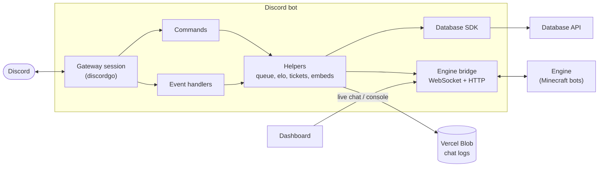
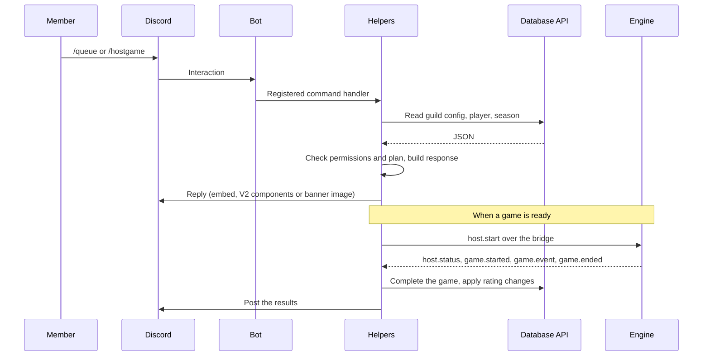

# Ranked Bedwars Discord Bot

The Discord front end of Ranked Bedwars, written in Go. It runs the queue, matchmaking, ranked games, moderation and support tickets for every registered server from one process. It keeps no state of its own: all data lives in the Ranked Bedwars Database, and all Minecraft work is done by the Engine.

## Where it fits
  


## How a command runs



## Responsibilities

| Area | What the bot does |
|---|---|
| Queue and matchmaking | Voice and text queues, LFG, picking (standard or captain), parties, substitutes |
| Games | Hosting, score, win and loss, void, rescore, game history and reversal, results posts |
| Ranking | Rating changes, wipes, decay, ranks and role rewards, leaderboards |
| Players | Registration (including Minecraft ownership checks), nickname and rename, profile and stats banners, premium |
| Moderation | Warn, mute, kick, ban, queue ban, strikes with punishment and strike ladders, screenshare requests |
| Tickets | Panels, thread or channel tickets, claim and close, transcripts, blacklist, staff leaderboard |
| Server setup | Slash commands, custom commands, panels and embeds built on the dashboard, per-server theme and wording |

Every server is configured on the dashboard. The bot reads that configuration through the Database at the moment it needs it, so changes apply without a restart.

## Layout

```
main.go                         start-up and shutdown
src/
  database/                     process-wide Database SDK client (database.Must())
  discord/
    discord.go                  session, intents, event registration, slash command sync
    commands/
      general/                  member commands: queue, stats, register, parties, history
      staff/                    staff commands: score, host, moderation, wipe, tickets
      admin/                    server setup and configuration
    events/                     gateway and interaction handlers (queue, game, panel, ticket, punishment)
    helpers/                    the domain logic behind commands and events
  types/                        shared structs: commands, events, tickets, embeds, panels
  config/fonts/                 fonts used when drawing banners
  utility/                      logging
scripts/gen_responses/          regenerates helpers/response_catalog.json
```

Commands and events register themselves from `init()` through `helpers.Register` and `helpers.RegisterEvent`, then `discord.go` attaches the event handlers and bulk-overwrites the slash commands. Adding a command is a new file in the right folder plus one `Register` call.

The helpers are split per domain (`queue_helper.go`, `elo_helper.go`, `ticket_helper.go`, `party_helper.go`, and so on), so a command file stays short and the rules live in one place.

## The Engine bridge

The bot is the brain and the Engine is the hands. When a game is ready the bot sends `host.start` over a WebSocket on `ENGINE_BRIDGE_ADDR`. The Engine hosts the game on the Minecraft server and reports progress back, and the bot turns that into Discord messages and database writes. If the bridge drops, the bot marks running games as lost and staff take over.

The same listener serves `/live/chat` and `/live/control` to the dashboard, behind `LIVE_CHAT_SECRET`, for the live chat preview and console. The frame types are defined in the Engine's `protocol.js` and in `helpers/engine_helper.go`; keep the two in step.

## Configuration

Copy `.env.example` to `.env`.

| Variable | Required | Purpose |
|---|---|---|
| `DISCORD_BOT_TOKEN` | yes | Bot token |
| `DATABASE_API_URL`, `DATABASE_API_KEY` | yes | Database API. A master key lets the bot serve every guild |
| `DATABASE_API_TIMEOUT` | no | Per-call limit, default 15s |
| `ENGINE_BRIDGE_ADDR`, `ENGINE_BRIDGE_SECRET` | no | Enable the Engine bridge. Without an address, games are hosted by hand |
| `LIVE_CHAT_SECRET` | no | Allows the dashboard's live chat and console |
| `BLOB_READ_WRITE_TOKEN` | no | Where finished games' chat logs are stored |
| `DEVELOPMENT_GUILD_ID` | no | Register slash commands in one server for instant updates |
| `PLAN_ENFORCEMENT`, `PLAN_GRANDFATHER_BEFORE` | no | Plan checks for servers, see the file for the values |
| `LOG_LEVEL` | no | `debug` (default), `info`, `warn` or `error` |

## Running it

```bash
go run .          # reads .env if present
go build -o bot . # release binary
```

Logs are written under `logs/` split into `global`, `discord`, `database` and `engine`; the Database SDK's request tracing goes to the file only.

After changing a command's built-in embeds, regenerate the response catalogue the dashboard lists:

```bash
go generate ./src/discord/helpers
```

## Depending on the Database module

The bot imports the Database repository as a Go module for its SDK and wire types, and pins a version in `go.mod`. The Database repository tags every successful push to `main`, and `.github/workflows/update-database.yml` moves this repository to the newest tag on every push or merge to `main`: it updates `go.mod` and `go.sum`, checks the bot still builds and vets, and commits the change back. It needs a `DATABASE_REPO_TOKEN` repository secret (read-only Contents access to the Database repository). To update by hand:

```bash
go get github.com/RubyDevelopment/Ranked-Bedwars-Database@vX.Y.Z
go mod tidy
```

When building on a host, the module comes from a private repository, so set `GOPRIVATE` and a read-only GitHub token for git as described in `.env.example`.
